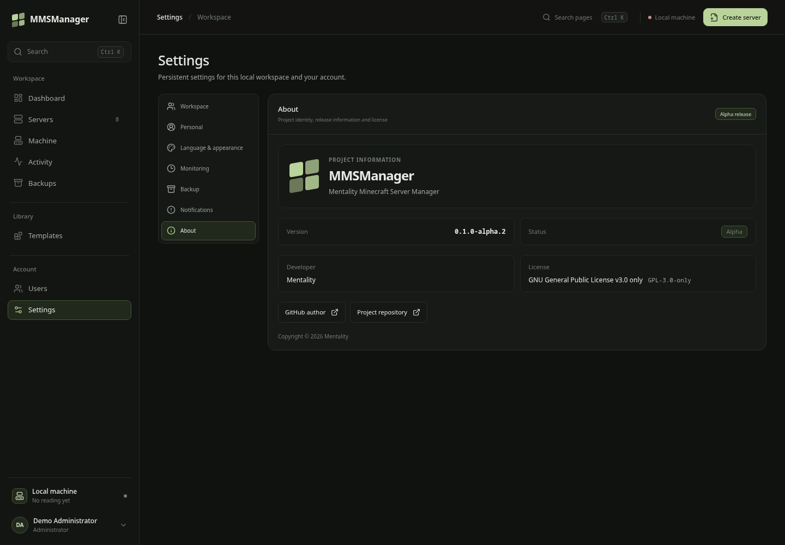
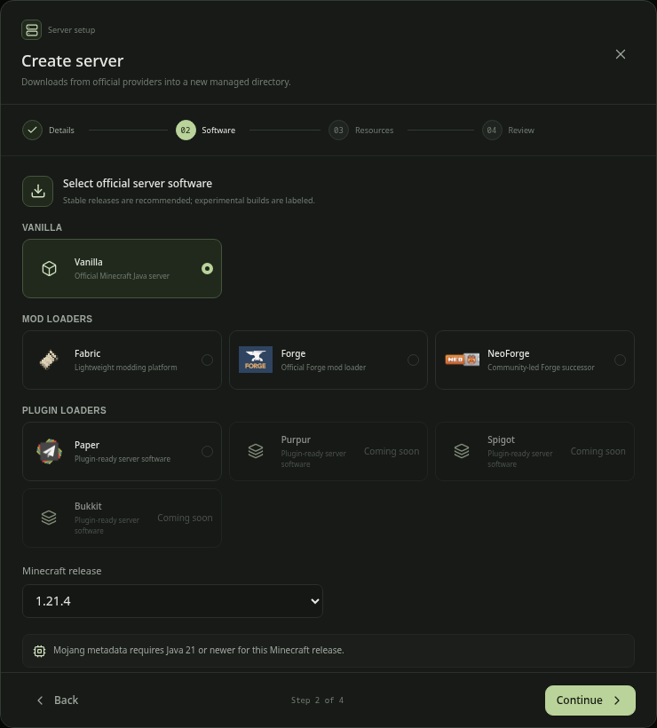
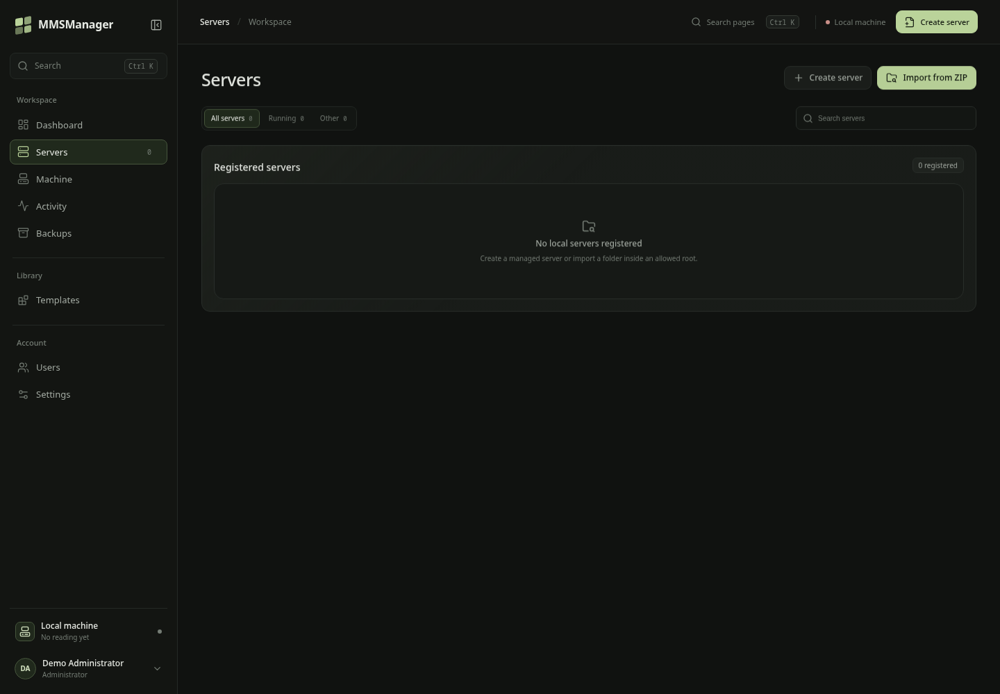
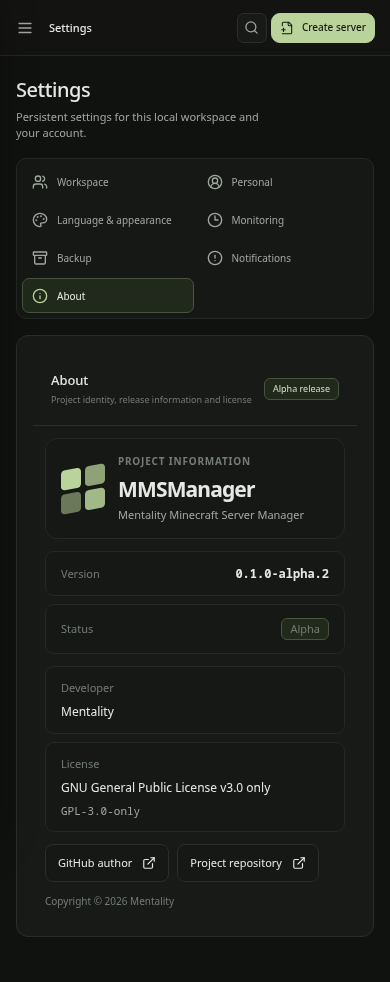

  

<h1 align="center">MMSManager</h1>

  <strong>Mentality Minecraft Server Manager</strong> 
  A local-first control panel for operating Minecraft servers on Linux.

  
  
  
  
  

  <a href="#screenshots">Screenshots</a> ·
  <a href="#features">Features</a> ·
  <a href="#requirements">Requirements</a> ·
  <a href="#installation">Installation</a> ·
  <a href="#production-deployment">Production deployment</a> ·
  <a href="#technology">Technology</a> ·
  <a href="#author">Author</a> ·
  <a href="#license">License</a>

## Screenshots

The captures use an isolated demonstration account and contain no real server records or host paths.

  

  

  

  

## Features

- Live CPU, memory, storage and network readings from the local Linux host, with persisted history and a local-time calendar.
- Local accounts with Administrator and Member roles, per-server access, profiles and personal preferences.
- A registry for local servers, ZIP import, retained-server recovery, and new Vanilla, Fabric, Forge, NeoForge or Paper installations through their official metadata services.
- Management controls for panel-owned processes, a bounded console and logs, typed server properties, files, Fabric mods, Paper plugins, players and world inventory.
- SQLite-backed backup limits shared by manual and scheduled snapshots, integrity-checked restore with a safety copy, and an archive download for stopped, panel-managed servers.
- Minecraft port synchronization from `server.properties` into the panel's cache, with separate configured and running-process ports and a restart notice when they differ.
- English and Russian interface text, light and dark themes, and three accent palettes.

Imported server directories remain unmanaged and read-only until explicitly adopted. Data that is unavailable stays unavailable; the interface does not invent server history or player activity.

## Requirements

- Linux for local host monitoring and server process management.
- Node.js 22.14 or newer.
- pnpm 10.26 or newer.
- A compatible Java runtime to install or run a Minecraft server.

## Installation

~~~sh
git clone https://github.com/sqwiziiy/MMSManager.git
cd MMSManager
pnpm install --frozen-lockfile
pnpm dev
~~~

Open <http://127.0.0.1:5173>. The local API listens on <http://127.0.0.1:4174>. Both services bind to loopback.

On first start, the API creates a one-time setup key and prints the path to its private local file in the terminal. Enter that key at /setup to create the first administrator. The key expires after 30 minutes and is consumed once. MMSManager does not create a default account or password.

To use another local port pair:

~~~sh
MMSMANAGER_WEB_PORT=5183 MMSMANAGER_API_PORT=4183 pnpm dev
~~~

Passwords are stored as Argon2id hashes. Sessions use HttpOnly cookies, same-origin checks and CSRF protection. Authorization is enforced by the local API.

## Local data

Application state is stored outside the checkout, by default in ${XDG_STATE_HOME:-$HOME/.local/state}/mmsmanager. Set MMSMANAGER_DATA_DIR to choose another private state directory. The SQLite database, session data, application configuration and server backups stay there. The default managed server root is the servers directory under the data path; MMSMANAGER_SERVER_ROOT can select another local directory.

Keep the API and development server on loopback. Do not add the database, setup key, app configuration, session files or backup archives to Git or the public web root.

## Production deployment

Build the web app and API from a reviewed checkout:

~~~sh
pnpm install --frozen-lockfile
pnpm build
~~~

For a same-origin HTTPS reverse-proxy setup on one Linux host, configure the API service with values such as:

~~~text
MMSMANAGER_SERVE_WEB=true
MMSMANAGER_WEB_ORIGIN=https://panel.example.com
MMSMANAGER_COOKIE_SECURE=true
MMSMANAGER_DATA_DIR=/var/lib/mmsmanager
MMSMANAGER_API_PORT=4174
~~~

Start the built API with pnpm --filter @minepanel/api start. It serves apps/web/dist and binds to 127.0.0.1:4174. Configure a maintained TLS reverse proxy to that loopback address, preserving the original Host and Origin. Do not expose the API port or run Vite as a public web server.

See the [deployment guide](deploy/README.md) and [systemd service example](deploy/mmsmanager.service.example). The reverse-proxy example has not been deployed or independently security-audited.

## Technology

MMSManager uses React, TypeScript, Vite and Lucide for the interface; Fastify and Zod for the local API; SQLite with Drizzle ORM for persistent state; and Linux system information libraries for local monitoring. pnpm manages the workspace and locked dependencies.

## Current limits

MMSManager targets one local Linux host. Remote hosts, SSH, RCON and Telegram are not included. Forge was verified with Minecraft 1.20.1 (Forge 47.4.28), and NeoForge with Minecraft 1.21.1 (NeoForge 21.1.268); these checks do not establish compatibility with every Minecraft or loader version. The API is not intended for direct LAN or public exposure. Validate server imports, backups and restores on disposable copies before using valuable worlds. The documented reverse-proxy setup has not been independently deployed or security-audited.

## Author

**Mentality**
[GitHub profile](https://github.com/sqwiziiy) · [MMSManager repository](https://github.com/sqwiziiy/MMSManager)

## License

Copyright © 2026 Mentality. MMSManager is distributed under the **GNU General Public License v3.0 only** ([GPL-3.0-only](LICENSE)). Third-party packages retain their own terms; see [third-party notices](THIRD_PARTY_NOTICES.md).
